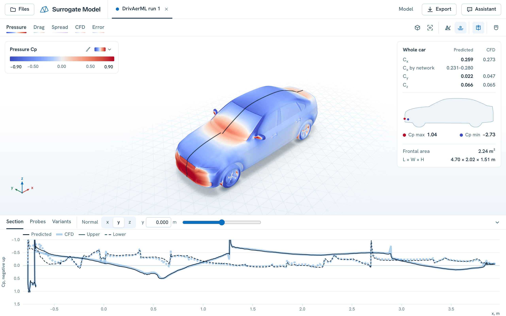

# Surface pressure surrogate for DrivAerML

A model that predicts the mean surface pressure coefficient (`CpMeanTrim`) at every cell of a car body from its geometry alone, and Surrogate Model, a browser tool for working with the prediction on a dropped `.vtp` file. The model is trained on the ten assigned [DrivAerML](https://huggingface.co/datasets/neashton/drivaerml) cases (runs 80, 98, 102, 208, 213, 281, 397, 425, 445, 474). On two test cars kept out of training (runs 1 and 500) it explains 96% of the variance of the CFD pressure (area-weighted $R^2$ `0.9558`).



## Run it

Needs [uv](https://docs.astral.sh/uv/), which installs Python (3.11 to 3.13) and the dependencies on first use. The repository as cloned holds the trained model and two analysed examples, so the tool won't need to download them:

```bash
uv run surrogate app
```

Open `http://127.0.0.1:8740/` in a browser with WebGPU (current Chrome, Edge or Safari), then drop a `boundary_i.vtp` file on the page or open one of the two bundled examples (runs 1 and 500). `--port` picks another port.

To run the model on a DrivAerML file from the command line, fetch the two holdout cars and predict one:

```bash
uv run surrogate fetch holdout     # runs 1 and 500, 1.3 GB -> data/raw/holdout/
uv run surrogate predict data/raw/holdout/run_1/boundary_1.vtp --output run_1_prediction.vtp
```

`predict` takes any `.vtp` surface, with or without `CpMeanTrim`, and asks the model at every cell (95 s for run 1's 8.8M cells on an Apple M5 Pro). It prints the car's size against the training cars', its coverage, the pressure drag and lift with each network's drag, and the spread, and when the file carries CFD pressure, also the CFD drag and lift and the area-weighted $R^2$ against them. `--output` writes the file back with the cell arrays `CpPredicted` and `CpSpread`, as the tool's export does, and `--json` writes the summary for scripts. The same from Python:

```python
from surrogate import SurrogateEnsemble, run_vtp_inference

ensemble = SurrogateEnsemble.load("artifacts/ensemble.pt")
result = run_vtp_inference("data/raw/holdout/run_1/boundary_1.vtp", ensemble)
```

`result` holds $C_p$ and its spread per cell; pressure drag and lift for the mean field and for each network; the car's size, frontal area and coverage by the training cars; cumulative drag from nose to tail; and, when the file carries CFD, the CFD forces and the agreement with them.

## Assistant

The Assistant panel holds an agent that works the tool with the engineer's own controls and a Python kernel in the browser. To enable it, set `OPENROUTER_API_KEY` in the environment or in `local/secrets/assistant.env`; without a key the panel says the assistant is not available and the rest of the tool works.

## Retrain and test

`uv run surrogate` lists its commands and what this copy holds, with the command that fills each gap. Retraining needs the twelve DrivAerML surface files (7.8 GB) and, for the bundled examples, Google Chrome:

```bash
uv run surrogate fetch       # the ten training and two holdout cars -> data/raw/
uv run surrogate reproduce   # each step whose output is not current, then the tool
uv run pytest                # about 10 minutes on an Apple M5 Pro
```

Of the steps `reproduce` runs, preprocessing takes 8 min and training 16 min on the GPU of an Apple M5 Pro.

## Read more

- [docs/model.md](docs/model.md): the approach, the inputs, training, the results table and findings, and the limitations.
- [docs/web-app.md](docs/web-app.md): what the tool does and how it runs in the browser.
- [docs/assistant.md](docs/assistant.md): what the assistant asks before doing, its Python kernel and its route to its model.
- [docs/demo-outline.md](docs/demo-outline.md): the outline of a customer demo.
- [docs/development.md](docs/development.md): reproducing the model step by step, the tests and lint, and the repository layout.

## Data and license

DrivAerML (Ashton et al., 2024) is licensed CC BY-SA 4.0; see [data/README.md](data/README.md) and `data/metadata/LICENSE.txt`. Only surface files are used, and only the ten assigned runs train the model.
